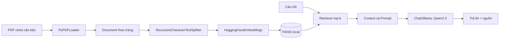

# 2. Lưu đồ xử lý của ứng dụng

## 2.1. Tổng quan



## 2.2. Lưu đồ chạy chương trình (bao gồm các trường hợp lỗi)

```mermaid
flowchart TD
    S([Bắt đầu]) --> P{Có file PDF?}
    P -- Không --> E1[Thông báo chép PDF] --> X([Kết thúc])
    P -- Có --> O{Ollama chạy, có model?}
    O -- Không --> E2[Hiện lệnh mở Ollama / pull model] --> X
    O -- Có --> M{PDF hoặc cấu hình thay đổi?}
    M -- Có --> L[Đọc PDF] --> T[Chia chunks] --> V[Tạo embedding & FAISS] --> W[Lưu index + manifest]
    M -- Không --> R[Tải FAISS tin cậy đã lưu]
    W --> Q[Nhập câu hỏi]
    R --> Q
    Q --> EXIT{Nhập exit/q/quit?}
    EXIT -- Có --> X
    EXIT -- Không --> EMPTY{Câu hỏi rỗng?}
    EMPTY -- Có --> Q
    EMPTY -- Không --> RET[Retriever lấy top-k chunks]
    RET --> CTX[Ghép context có file & trang]
    CTX --> LLM[Prompt | ChatOllama | StrOutputParser]
    LLM --> OUT[In câu trả lời, nguồn truy xuất, thời gian]
    OUT --> LOG[Lưu JSONL]
    LOG --> Q
```

## 2.3. Lời thuyết trình lưu đồ (khoảng 1 phút)

“Ứng dụng của nhóm có hai giai đoạn. Ở giai đoạn đầu, chương trình kiểm tra folder PDF, đọc từng trang bằng PyPDFLoader, chia trang thành nhiều chunks với overlap rồi biến chúng thành embeddings để lưu trong FAISS. Nếu PDF không đổi thì lần sau tái sử dụng index. Ở giai đoạn hai, người dùng gõ câu hỏi, retriever tìm tối đa bốn chunks liên quan, ghép chúng thành context và chuyển vào prompt của mô hình Qwen2.5 qua LangChain ChatOllama. Cuối cùng chương trình hiện câu trả lời, tên PDF, trang đã truy xuất và thời gian xử lý. Nếu không có PDF hoặc Ollama chưa sẵn sàng thì báo lỗi thay vì chạy tiếp.”
